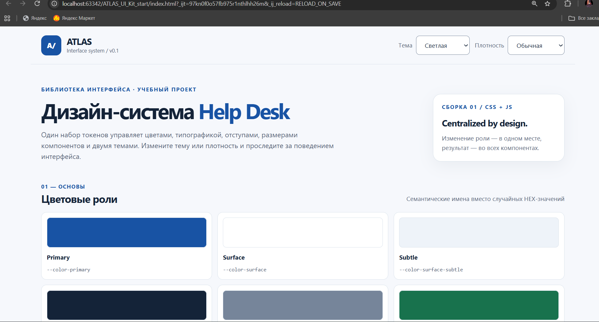
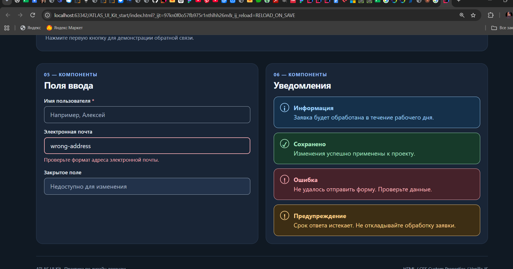
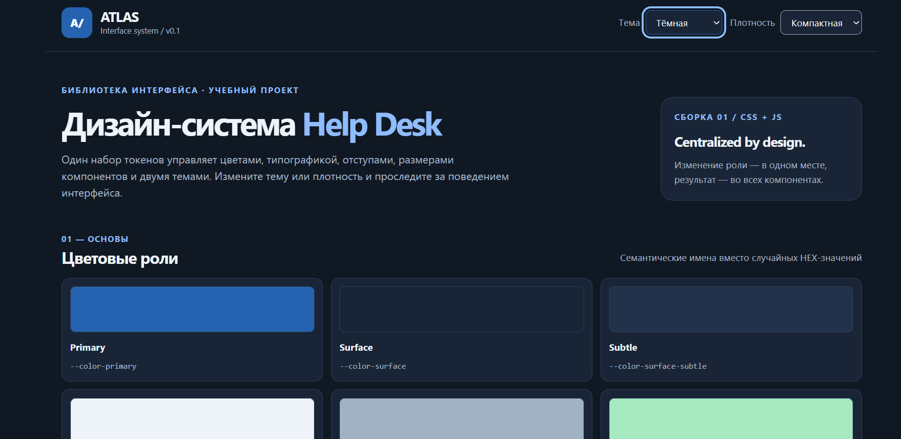
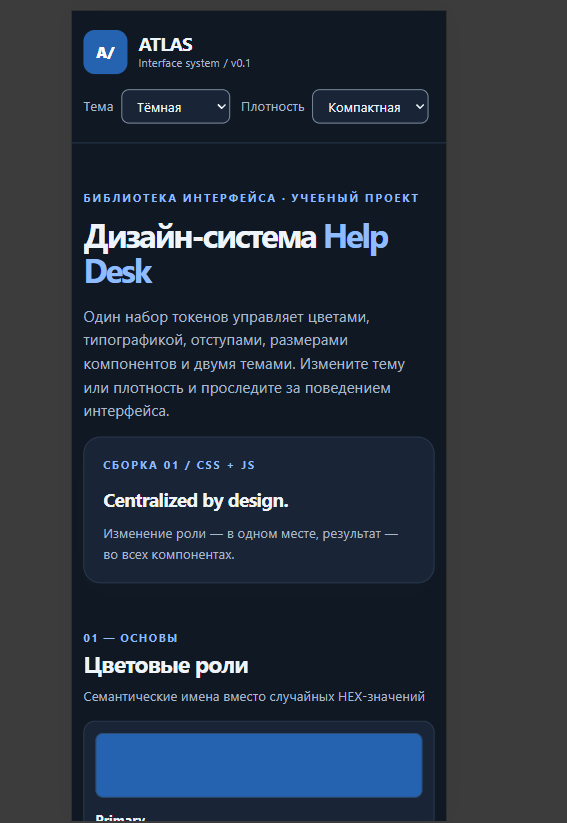

# ATLAS UI Kit — технический UI Kit для Help Desk

Практическая работа № 5 «Дизайн-токены и техническая дизайн-система».
Учебная библиотека интерфейса: токены, светлая и тёмная темы, компактный режим, кнопки, поля и уведомления со всеми состояниями.
Без Bootstrap, Tailwind и UI-библиотек: HTML, CSS Custom Properties и Vanilla JS.

## Запуск

Из папки с `index.html`:

```bash
python -m http.server 5500
```

Откройте http://localhost:5500. Можно запускать через встроенный сервер IntelliJ IDEA или Live Server.

## Исходная проблема и план

**Проблема.** Одни и те же визуальные решения в формах, списке заявок и админ-панели были заданы разными значениями: близкие оттенки синего, разные отступы. Смена фирменного цвета требовала правки во многих местах, тёмной темы и компактного режима не было.

**План.**
1. Проверить три уровня токенов в `tokens.css` и добавить тёмную тему через переопределение семантических ролей.
2. Реализовать выбор темы auto/light/dark с сохранением в `localStorage`.
3. Завершить кнопки, поля и уведомления в `components.css` только через токены, без HEX.
4. Добавить компактный режим через компонентные токены и уведомление warning.
5. Проверить ширины 320–1440 px, клавиатуру, контраст и обе темы.

## Структура проекта

```
index.html           — демонстрационная страница UI Kit (семантическая разметка)
css/tokens.css       — все значения: примитивы, роли, компонентные токены, темы, плотность
css/components.css   — внешний вид компонентов и их состояния (только var(), без HEX)
js/theme.js          — выбор темы и плотности, сохранение в localStorage
screenshots/         — снимки экрана для сдачи
```

`tokens.css` подключается раньше `components.css`: сначала объявляются значения, затем правила, которые их используют.

## Архитектура токенов: primitive → semantic → component

| Уровень | Что описывает | Пример |
|---|---|---|
| Примитив `--base-*`, `--space-*` | само значение без роли | `--base-blue-700: #1853a4` |
| Семантика `--color-*` | назначение в интерфейсе | `--color-primary: var(--base-blue-700)` |
| Компонент `--button-*`, `--control-*` | роль в конкретном компоненте | `--button-bg-primary: var(--color-primary)` |


## Темы

| Режим | Состояние `<html>` | Какое правило работает |
|---|---|---|
| Системная (auto) | атрибута `data-theme` нет | `@media (prefers-color-scheme: dark) { :root:not([data-theme]) { … } }` |
| Светлая | `data-theme="light"` | значения по умолчанию из `:root` |
| Тёмная | `data-theme="dark"` | `:root[data-theme="dark"] { … }` |

- В тёмной теме переопределены только семантические роли: page, surface, surface-subtle, text, text-muted, border, border-control, primary (+hover/active), on-primary, link, focus-ring, info/success/error/warning и их фоны. Компоненты не меняются.
- В обеих тёмных ветках задано `color-scheme: dark`, чтобы браузер оформил встроенные элементы (скроллбар, список выбора).
- **Приоритет ручного выбора:** системное правило применяется только к `:root:not([data-theme])`. Если пользователь выбрал тему, атрибут есть, и системная настройка больше не действует.
- `theme.js` принимает только `auto`, `light`, `dark` (иначе `auto`), для `auto` удаляет атрибут, сохраняет выбор под ключом `atlas-theme`. Обращения к `localStorage` обёрнуты в `try/catch`: если хранилище недоступно, переключение продолжает работать.

## Компоненты и состояния

| Компонент | Варианты | Состояния |
|---|---|---|
| Кнопка `.button` | `--primary`, `--secondary`, `--ghost` | hover, active, focus-visible, disabled |
| Поле `.input`, список `.select` | — | placeholder, focus, disabled, invalid (`aria-invalid="true"`) |
| Уведомление `.alert` | `--info`, `--success`, `--error`, `--warning` | символ + заголовок + текст |

- Hover и active написаны с `:not(:disabled)`, поэтому отключённая кнопка не реагирует на указатель.
- Фокус задан глобально через `:focus-visible` (`outline` 3px `--color-focus-ring`) и нигде не отключается.
- Ошибка поля: красная рамка 2px, текст ошибки связан с полем через `aria-describedby="email-error"`. Признак ошибки не только цвет.
- Рамка и символ уведомления окрашены через `currentColor`, поэтому вариант задаётся двумя токенами (текст и фон).
- `.alert > div { min-width: 0; overflow-wrap: anywhere; }` защищает от горизонтального переполнения на узком экране.

## Самостоятельная часть

### Компактный режим

Список «Плотность» (`#density-select`), атрибут `data-density="compact"` на `<html>`, ключ `atlas-density`.

| Токен | Обычный | Компактный |
|---|---|---|
| `--button-height` | 2.75rem (44px) | 2.25rem (36px) |
| `--control-height` | 2.75rem (44px) | 2.25rem (36px) |
| `--button-padding-inline` | `--space-5` (20px) | `--space-4` (16px) |
| `--control-padding-inline` | `--space-4` (16px) | `--space-3` (12px) |
| `--component-gap` | `--space-3` (12px) | `--space-2` (8px) |
| `--alert-padding` | `--space-4` (16px) | `--space-3` (12px) |

Ни одно правило `.button` или `.input` не продублировано: компоненты уже читают эти токены.

### Предупреждение

`.alert--warning` с ролями `--color-warning` и `--color-warning-bg`, определёнными в светлой и обеих тёмных ветках. Символ «!», заголовок «Предупреждение», `role="alert"`: срок ответа истекает, сообщение срочное.

## Скриншоты

| Светлая тема | Тёмная тема |
|---|---|
|  |  |

| Тёмная + компактная | Мобильная ширина 320 px |
|---|---|
|  |  |
